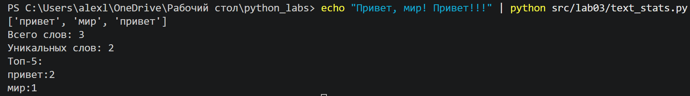

# python_labs 

# Лабораторная работа 2

# Лисёнков Алексей
##
## Задание 1 - text.py

Преобразует строку: приведение к нижнему регистру (casefold), замена ё/Ё на е/Е и удаление управляющих символов и лишних пробелов.
### Код под normalize:
```python
def normalize(text: str, *, casefold: bool = True, yo2e: bool = True) -> str:
    if casefold:
        text = text.casefold()
    else: 
        text = text.lower()
    if yo2e:
        text = text.replace('Ё' ,'Е').replace('ё','е')
    text = ' '.join(text.split())

    return text
```

### Пример запуска normalize:

.png)

Разбивает текст на слова (буквы, цифры, знак подчеркивания) по разделителям, сохраняя дефисы внутри слов.
### Код под tokenize:
```python
import re
def tokenize(text: str) -> list[str]:
    matches = re.finditer(r'\w+(-\w+)*', text)
    newtext = []
    for alphas in matches:
        newtext.append(alphas.group())
    return newtext
```

### Пример запуска tokenize:

.png)

count_freq подсчитывает частоту встречаемости токенов за линейное время 
### Код под count_freq:
```python
def count_freq(tokens: list[str]) -> dict[str, int]:
    word_counts = {}

    for token in tokens:
        if token in word_counts:
            word_counts[token] += 1
        else:
            word_counts[token] = 1

    return dict(sorted(word_counts.items()))
```
### Пример запуска count_freq:

.png)

top_n возвращает первые N частых слов с алфавитной сортировкой при равенстве частот.
### Код под top_n:

```python
def top_n(freq: dict[str, int], n: int = 5) -> list[tuple[str, int]]:
    freqs = sorted(freq.items(), key = lambda x: (-x[1], x[0]))[:n]
    return freqs
```

### Пример запуска top_n:

.png)


## Задание 2 - text_stats.py


Скрипт читает весь ввод из stdin до EOF (`sys.stdin.read()`).
Этот способ работает и для одной строки, и для многострочного текста.

Вызывает функции из `src/lib/text.py` и печатает:

1. Всего слов: N
2. Уникальных слов: K
3. Топ-5: и строки слово:кол-во (по убыванию частоты, при равенстве по алфавиту)

### Запуск

    echo "Привет, мир! Привет!!!" | python src/lab03/text_stats.py

### Результат

    Всего слов: 3
    Уникальных слов: 2
    Топ-5:
    привет:2
    мир:1

### Код под text_stats:

```python
import sys
from pathlib import Path

sys.path.insert(0, str(Path(__file__).resolve().parent.parent))

from lib.text import normalize, tokenize, count_freq, top_n


def main() -> None:
    sys.stdin.reconfigure(encoding="utf-8")
    raw_text = sys.stdin.read()

    tokens = tokenize(normalize(raw_text))
    freq = count_freq(tokens)
    print(f"Всего слов: {len(tokens)}")
    print(f"Уникальных слов: {len(freq)}")
    print("Топ-5:")
    for word, count in top_n(freq, n=5):
        print(f"{word}:{count}")


if __name__ == "__main__":
    main()
```

### Пример запуска text_stats:




