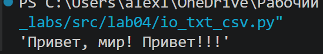
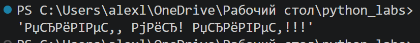
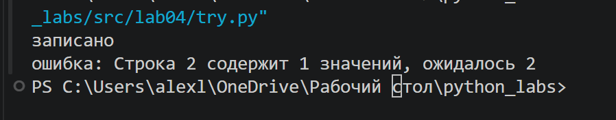
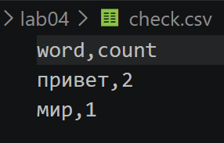
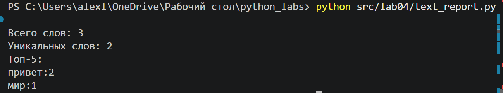
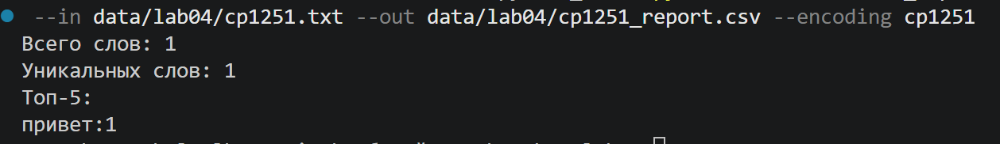
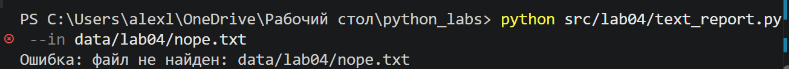

 Задание A - io_txt_csv.py

Реализован модуль для чтения текстовых файлов и записи результатов в CSV. Для работы с путями используется Path, а для формирования CSV — стандартный модуль csv.

Реализованы следующие функции:  

## 1. Функция **read_text**

Функция читает файл целиком и возвращает его содержимое в виде одной строки. По умолчанию используется кодировка UTF-8, но при необходимости можно передать другую кодировку, например encoding="cp1251".

Если файл не найден, возникает FileNotFoundError. При несовпадении кодировки возникает UnicodeDecodeError.
### Код для функции:
```python
def read_text(path: str | Path, encoding: str = "utf-8") -> str:
    p = Path(path)
    return p.read_text(encoding=encoding)
```
#### При правильной кодировке


#### При иной кодировке:


## 2. Функция **write_csv**

Функция записывает строки в CSV-файл. Перед записью проверяется, что все строки имеют одинаковую длину. Если длины отличаются, вызывается ValueError

#### Пример когда длины строк отличаются:


 Сначала проверяется заголовок и если он есть то его длина выбирается за эталонную. Если передан параметр header, он записывается первой строкой файла.
### Код для этой функции:
```python
def write_csv(
        rows:Iterable[Sequence],
        path: str | Path,
        header: tuple[str, ...]| None = None,
) -> None:
    rows = list(rows)

    if header is not None:
        expected = len(header)
    elif rows:
        expected = len(rows[0])
    else:
        expected = None

    for number, row in enumerate(rows, start=1):
        if len(row) != expected:
            raise ValueError(
                f'Строка {number} содержит {len(row)} значений, ожидалось {expected}'
            )
    ensure_parent_dir(path)
    with Path(path).open('w', newline = '', encoding='utf-8') as f:
        writer = csv.writer(f)
        if header is not None:
            writer.writerow(header)
        writer.writerows(rows)
```
## 3. Функция **ensure_parent_dir**

Функция проверяет наличие родительской папки и создает ее вместе со всеми отсутствующими вложенными папками.

### код для этой функции
```python
def ensure_parent_dir(path: str | Path) -> None:
    Path(path).parent.mkdir(parents=True, exist_ok=True)
```


#### Пример запуска


 Результат записи данных в CSV-файл

# Задание B - скрипт статистики text_report.py

Скрипт читает текстовые файлы, использует функции normalize, tokenize, count_freq и top_n из лабораторной работы №3, а затем сохраняет частоты слов в CSV-файлы.


## Пример запуска для одного файла

```bash
python src/lab04/text_report.py
```
В этом режиме читается data/lab04/input.txt, т.к они записаны как дефолтные в коде, а результат записывается в data/lab04/report.csv. 
#### Пример запуска


## Запуск файла с нестандартной кодировкой
```bash
python src/lab04/text_report.py --in data/lab04/cp1251.txt
```
#### Кодировка cp1251


## Запуск несуществующего файла
```bash
python src/lab04/text_report.py --in data/lab04/nope.txt
```

#### Пример запуска


