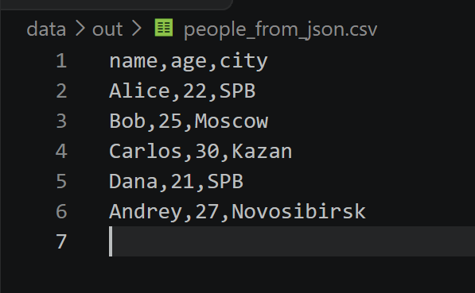
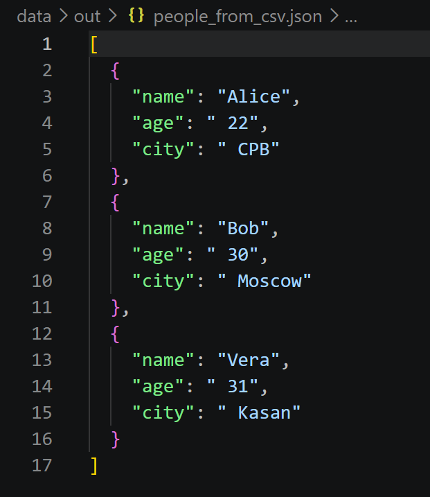
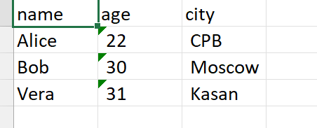
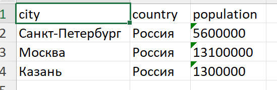
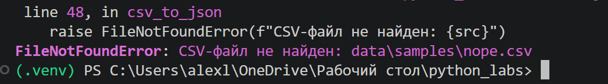
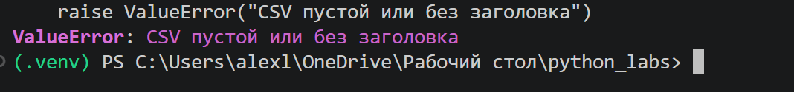

# Задание A - json_csv.py

Реализованы следующие функции:  

## 1. Функция **json_to_csv**

Преобразует JSON-файл (список словарей) в CSV. Колонки - объединение ключей всех объектов в порядке первого появления; если у объекта нет ключа, в ячейке пустая строка. Проверяет наличие файла и расширения (`.json`, `.csv`), читает JSON в UTF-8 и убеждается, что это непустой список словарей. Ошибки: `FileNotFoundError`, `ValueError`

### Код для функции:
```python
def json_to_csv(json_path: str, csv_path: str) -> None:


    src = Path(json_path)
    dst = Path(csv_path)


    if not src.exists():
        raise FileNotFoundError(f'JSON файл не найден {src}')
    if src.suffix.lower() != '.json':
        raise ValueError(f'Ожидался JSON, получен {src.name}')
    if dst.suffix.lower() != '.csv':
        raise ValueError(f'Ожидался файл CSV, получен {dst.name}')
    
    with src.open("r", encoding="utf-8") as f:
        try:
            data = json.load(f)
        except json.JSONDecodeError as e:
            raise ValueError(f"Некорректный или пустой JSON: {e}") from e
        if not isinstance(data, list) or not data:
            raise ValueError('Пустой JSON или неподдерживаю структуру')
        if not all(isinstance(item, dict) for item in data):
            raise ValueError('Все элементы Json списка должны быть словарями')

        fieldnames: list[str] = []
        for item in data:
            for key in item:
                if key in item:
                    if key not in fieldnames:
                        fieldnames.append(key)
        ensure_parent_dir(dst)
        with dst.open('w', newline='', encoding= 'utf-8') as f:
            writer = csv.DictWriter(f, fieldnames=fieldnames)
            writer.writeheader()
            writer.writerows(data)
```
#### Результат работы



## 2. Функция **csv_to_json**

Преобразует CSV в JSON (список словарей). Первая строка — обязательный заголовок, каждая следующая строка становится словарём, все значения остаются строками. Ошибки: `FileNotFoundError`, `ValueError`

### Код для функции:
```python
def csv_to_json(csv_path: str, json_path: str) -> None:
    src = Path(csv_path)
    dst = Path(json_path)

    if not src.exists():
        raise FileNotFoundError(f"CSV-файл не найден: {src}")
    if src.suffix.lower() != ".csv":
        raise ValueError(f"Ожидался файл .csv, получен: {src.name}")
    if dst.suffix.lower() != ".json":
        raise ValueError(f"Ожидался файл .json, получен: {dst.name}")

    with src.open("r", newline="", encoding="utf-8") as f:
        reader = csv.DictReader(f)
        if reader.fieldnames is None:
            raise ValueError("CSV пустой или без заголовка")
        rows = list(reader)

    if not rows:
        raise ValueError("CSV не содержит строк данных")

    ensure_parent_dir(dst)
    with dst.open("w", encoding="utf-8") as f:
        json.dump(rows, f, ensure_ascii=False, indent=2)
```
#### Результат работы



## 3. Функция **ensure_parent_dir** (была взята с lib)

Создаёт родительские папки для указанного пути, если их нет. Используется перед записью выходных файлов, чтобы папка `data/out/` создавалась автоматически

### Код для функции
```python
def ensure_parent_dir(path: str | Path) -> None:
    Path(path).parent.mkdir(parents=True, exist_ok=True)
```

# Задание B - csv_xlsx.py

Конвертирует CSV в Excel-файл через `openpyxl`. Первая строка CSV — заголовок, лист `Sheet1`. Ширина колонки равна длине самого длинного значения в ней, но не меньше 8 символов. Значения записываются как текст. Ошибки: `FileNotFoundError` (нет файла), `ValueError` (неверное расширение входного или выходного файла, пустой CSV)

### Код для функции:
```python
import csv
from pathlib import Path

from openpyxl import Workbook
from openpyxl.utils import get_column_letter

from src.lib.io_helpers import ensure_parent_dir


def csv_to_xlsx(csv_path: str, xlsx_path: str) -> None:

    src = Path(csv_path)
    dst = Path(xlsx_path)

    if not src.exists():
        raise FileNotFoundError(f"CSV-файл не найден: {src}")
    if src.suffix.lower() != ".csv":
        raise ValueError(f"Ожидался файл .csv, получен: {src.name}")
    if dst.suffix.lower() != ".xlsx":
        raise ValueError(f"Ожидался файл .xlsx, получен: {dst.name}")

    with src.open("r", newline="", encoding="utf-8") as f:
        rows = list(csv.reader(f))

    if not rows:
        raise ValueError("CSV пустой")

    wb = Workbook()
    ws = wb.active
    ws.title = "Sheet1"

    for row in rows:
        ws.append(row)

    widths: dict[int, int] = {}
    for row in rows:
        for idx, value in enumerate(row, start=1):
            widths[idx] = max(widths.get(idx, 0), len(value))

    for idx, width in widths.items():
        ws.column_dimensions[get_column_letter(idx)].width = max(width, 8)

    ensure_parent_dir(dst)
    wb.save(str(dst))

```
#### Пример работы people


#### Пример работы cities



### Проверки вывода ошибок

#### Пример запуска несуществующего файла


#### Пример запуска пустого файла



