# Лабораторная работа №6

## Лисёнков Алексей Сергеевич

## БИВТ-26-6-1

# CLI_TEXT

## 1. Функция **cat_command**
### Основная информация

Функция принимает на вход путь к файлу и выводит каждую его строку с нумерацией или без в зависимости от того, укажет ли пользователь соответствующий аргумент или нет(-n). Команда проверяет наличие файла, кодировку utf-8 (обязательно!)

### Код для функции
```python
def cat_command(input_path:str, numbers: bool = False) -> None:
    path = Path(input_path)

    if not path.is_file():
        raise FileNotFoundError("Файл не найден")
    
    with open(path, "r", encoding='utf-8') as f:
        for num, line in enumerate(f, start = 1):
            if numbers:
                print(f"{num} {line}", end="")
            else:
                print(f"{line}", end="")
```
#### Запуск cat без n
```bash
python -m src.lab06.cli_text cat --input data/samples/people.csv 
```
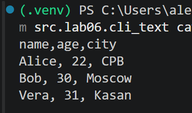

#### Запуск cat с n
```bash
python -m src.lab06.cli_text cat --input data/samples/people.csv -n
```
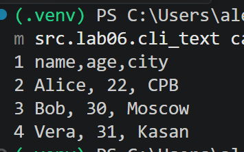


## 1. Функция **stats_command**
### Основная информация

Команда приниимает на вход путь к файлу, который кодирован utf-8, проверяет его наличие и обрабатывает слова. С помощью функций из ЛР3 создает статистику и выводит ее в виде таблицы. В зависимости от переданного аргумента в top, будет выводиться топ из стольки слов

### Код для функции
```python
def stats_command(input_path: str, top: int = 5) -> None:
    path = Path(input_path)

    if not path.is_file():
        raise FileNotFoundError("Файл не найден")

    text = read_text(input_path)
    
    tokens = tokenize(normalize(text))
    freq = count_freq(tokens)

    total_words = len(tokens)
    unique_words = len(freq)
    top_words = top_n(freq, top)

    print(f'Всего слов: {total_words}')
    print(f'Уникальных слов: {unique_words}')
    print(f'Топ-{top}:')
    for w, c in top_words:
        print(f"{w}:{c}")
```
#### Запуск stats без top
```bash
python -m src.lab06.cli_text stats --input data/samples/people.txt 
```
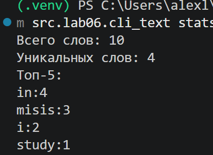

#### Запуск stats с top 2
```bash
python -m src.lab06.cli_text stats --input data/samples/people.txt --top 2
```
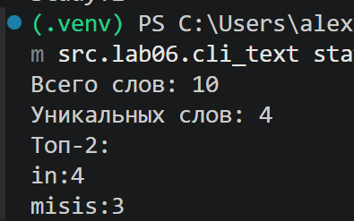


### ОШИБКИ

#### top некорректен
```bash
python -m src.lab06.cli_text stats --input data/samples/people.txt --top -3 
```
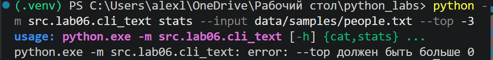

#### нет файла
```bash
python -m src.lab06.cli_text cat --input data/samples/no.csv
```
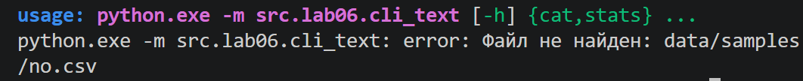


### HELP

#### help на всю функцию
```bash
python -m src.lab06.cli_text --help 
```
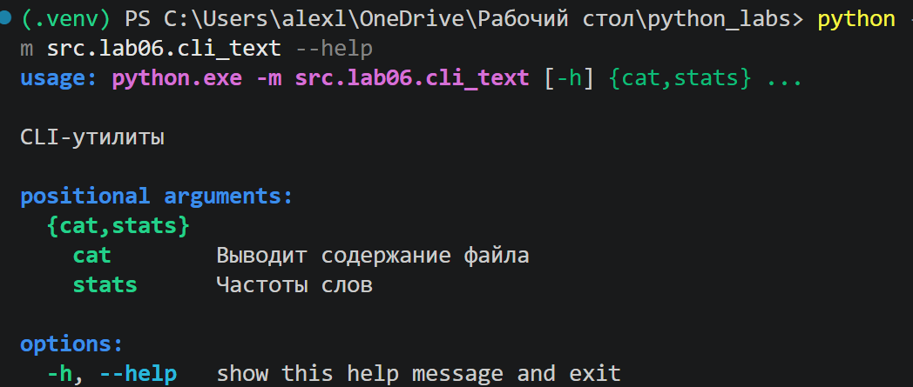

#### help на cat
```bash
python -m src.lab_06.cli_text cat --help
```
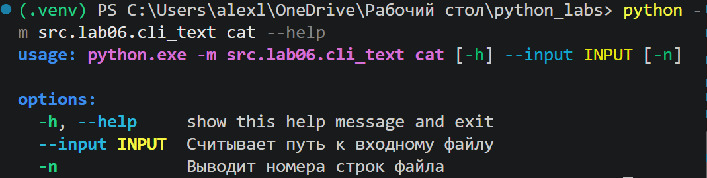

#### help на stats
```bash
python -m src.lab06.cli_text stats --help
```
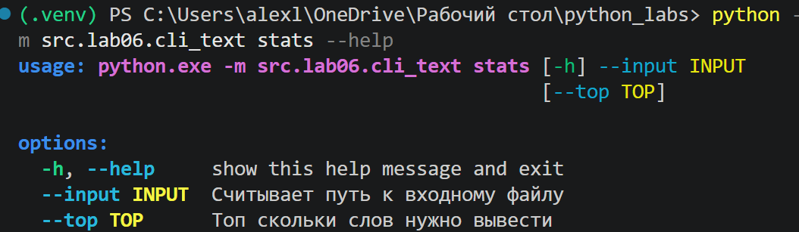

## CLI CONVERT
### Основная информация

Программа реализует интерфейс для управления функциями, реализованными в ЛР5. С помощью argparse определяются три подкоманды, каждая подкоманда принимает два обязательных аргумента: --in для указания исходного файла и --out для указания выходного файла. После обработки аргументов программа определяет выбранную подкоманду и вызывает соответствующую функцию

### Код для функции
```python
def main():
    parser = argparse.ArgumentParser(description="Конвертеры данных между JSON, CSV и XLSX")
    subparsers = parser.add_subparsers(dest = "command", required=True)

    json2csv_parser = subparsers.add_parser("json2csv", help = "JSON -> CSV")
    json2csv_parser.add_argument("--in", dest = "input", required = True, help = "Входной файл JSON")
    json2csv_parser.add_argument("--out", dest = "output", required = True, help = "Выходной файл CSV")

    csv2json_parser = subparsers.add_parser("csv2json", help = "CSV -> JSON")
    csv2json_parser.add_argument("--in", dest = "input", required = True, help = "Входной файл CSV")
    csv2json_parser.add_argument("--out", dest = "output", required = True, help = "Выходной файл JSON")

    csv2xlsx_parser = subparsers.add_parser("csv2xlsx", help = "CSV -> XLSX")
    csv2xlsx_parser.add_argument("--in", dest = "input", required = True, help = "Входной файл CSV")
    csv2xlsx_parser.add_argument("--out", dest = "output", required = True, help = "Выходной файл XLSX")

    args = parser.parse_args()

    try:
        if args.command == "json2csv":
            json_to_csv(Path(args.input), Path(args.output))
        
        elif args.command == "csv2json":
            csv_to_json(Path(args.input), Path(args.output))
        
        elif args.command == "csv2xlsx":
            csv_to_xlsx(Path(args.input), Path(args.output))
    except FileNotFoundError:
        parser.error(f"Файл не найден: {args.input}")
    except UnicodeDecodeError:
        parser.error(f"Файл {args.input} написан в кодировке, отличной от UTF-8")
    except ValueError as error:
        parser.error(str(error))
```
#### Запуск JSON > CSV
```bash
python -m src.lab06.cli_convert json2csv --in data/samples/people.json --out data/out/people_from_json.csv
```
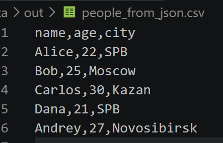

#### Запуск CSV > JSON
```bash
python -m src.lab06.cli_convert csv2json --in data/samples/people.csv --out data/out/people_from_csv.json  
```
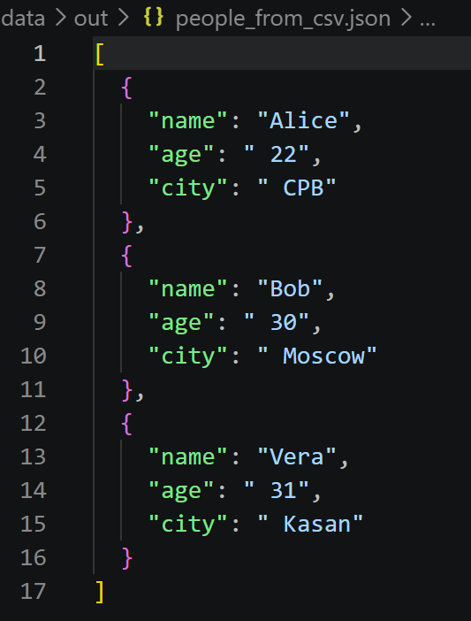

#### Запуск CSV > XLSX
```bash
python -m src.lab06.cli_convert csv2xlsx --in data/samples/people.csv --out data/out/people.xlsx   
```


### HELP

#### help на все
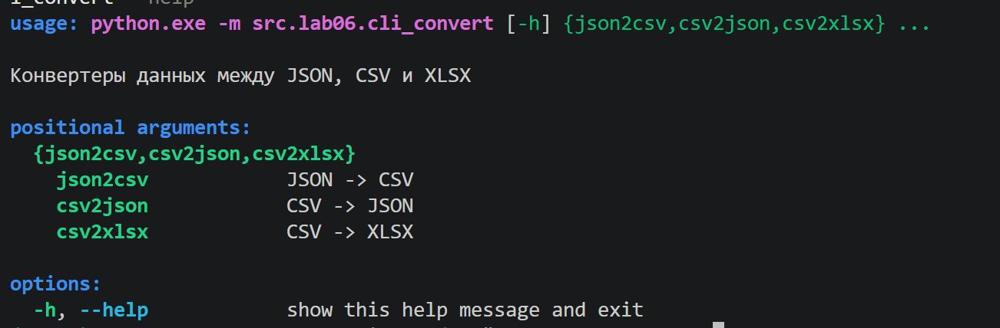

#### help на сsv2json
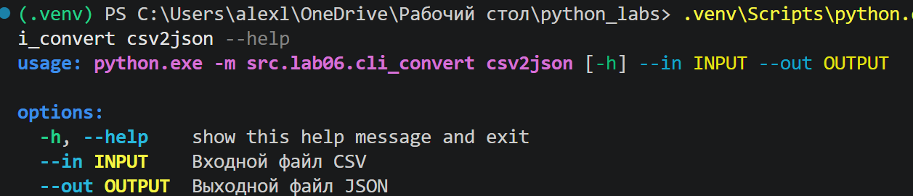

#### help на json2csv

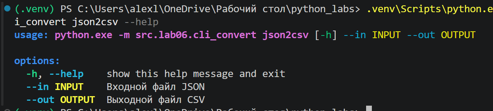

#### help на csv2xlsx
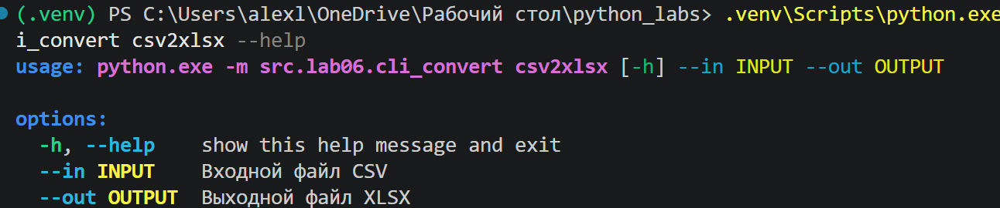